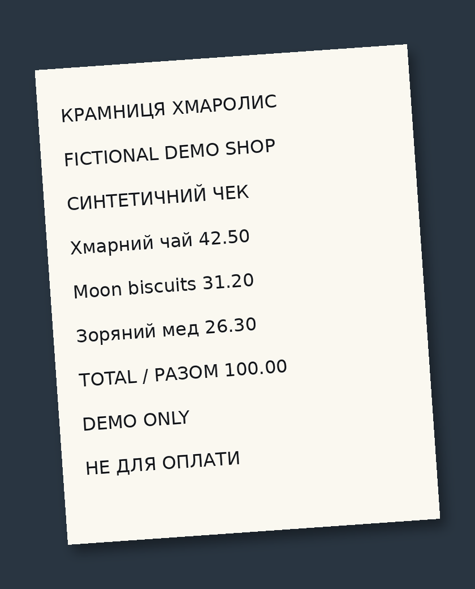
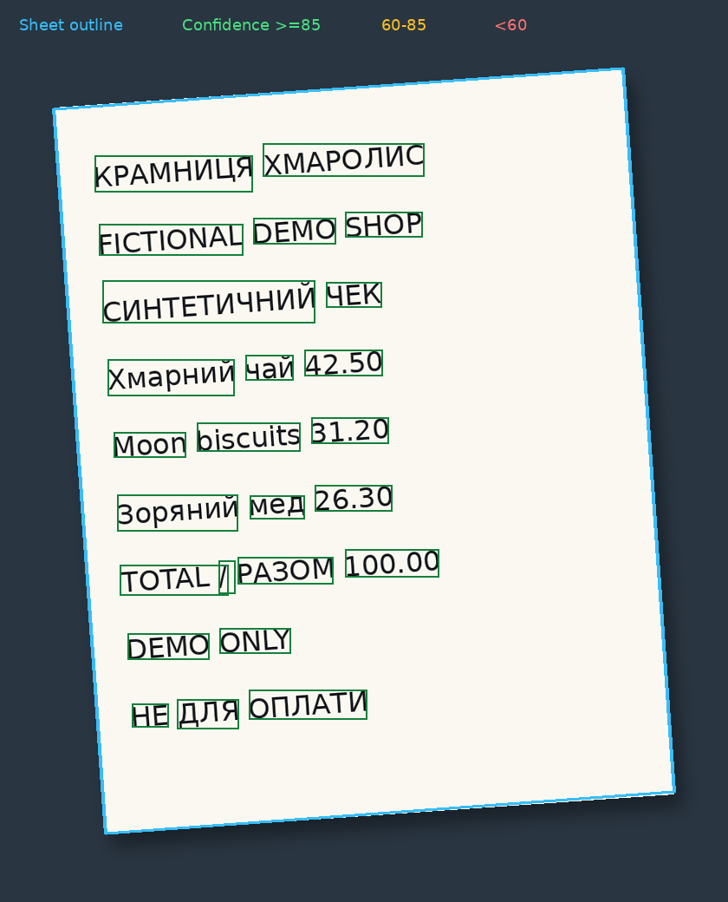

# Автономный Tesseract OCR — рабочая версия, цель 95% НЕ подтверждена

## Назначение
Локальное распознавание фотографий текста на украинском, русском и английском. Рабочие `ocr.py` и `autotess.py` не читают эталоны, учетные книги, классификации фотографий, заранее известные суммы/даты или координаты полей. Никаких LLM, облачных OCR и исправлений по бухгалтерским равенствам. Результат не является подтверждённой бухгалтерской проводкой. Для рукописи приемлемая точность не подтверждена.

## Запуск на этом компьютере

В рабочем каталоге разработчика уже создано отдельное `.venv` и установлены зависимости. В ZIP окружение не включено: после новой распаковки сначала запустите `SETUP.cmd`. Tesseract установлен отдельно в `C:\Program Files\Tesseract-OCR\tesseract.exe`.

1. Перетащите фотографию или папку фотографий на `RUN_OCR.cmd`.
2. Дождитесь завершения. Результаты будут в `results`: `.ocr.json`, `.ocr.txt`, `manifest.json`.
3. Проверяйте распознанный текст и альтернативы. Не переносите деньги в учёт без проверки.

Для новой установки: установленный Tesseract 5, `uv`, затем `SETUP.cmd`. Модели `ukr/rus/eng` должны находиться в `models`; их контрольные суммы — `model_manifest.json`. Скачать и проверить: `python scripts/download_models.py`. Дополнительный путь к Tesseract задаётся переменной `TESSERACT_CMD`.

Проверенная командная строка Windows:

```
.venv\Scripts\python.exe -E ocr.py --input "C:\путь\к\фото" --output "results" --mode accurate
```

`--mode accurate` — основной проверяемый профиль. `--mode quick` — исходная картинка одним проходом, без улучшений. `--mode experimental` — дополнительная бинаризация Sauvola и альтернативный порядок строк; включать только для экспериментов, улучшение качества не подтверждено. `--pattern` ограничивает имена файлов, но не задаёт искомый текст. `--workers` от 1 до 4; по умолчанию 2. Во время OCR сетевых запросов нет.

## Обработка

- Поиск светлых листов по геометрии, без предопределённого макета.
- Выбор поворота из четырёх направлений по качеству OCR.
- Коррекция небольшого наклона, координаты результата возвращаются к исходному изображению.
- Неизменённый серый вариант, нормализация освещения, увеличение, удаление линий сетки, бинаризация.
- Модели Tesseract `tessdata_best`, режимы разбиения 6 и 11.
- Локальный выбор уже распознанных слов из нескольких проходов; символы не дописываются по ожидаемому ответу.
- Дополнительное распознавание автоматически найденных групп текста, увеличенных и размещённых на отдельном служебном изображении. Геометрия берётся из OCR, не из эталона.
- Сохраняются все проходы, координаты и варианты. Уверенность Tesseract НЕ равна вероятности правильности и НЕ доказывает достижение 95%.

## Пример

Полностью синтетический чек вымышленного магазина на украинском и английском, слегка повёрнутый на тёмном фоне. Пересоздать: `python scripts/make_demo.py` (обычные зависимости/модели и DejaVu Sans либо `--font path/to/font.ttf`); запускается настоящий профиль `accurate`.

| Синтетический снимок | Найденный лист и слова |
| --- | --- |
|  |  |

Голубым показана найденная граница листа; рамки слов — зелёные (уверенность ≥85), жёлто-коричневые (60–<85) или красные (<60). Уверенность Tesseract не является вероятностью правильности.

Фрагмент фактического результата из [`demo_output.json`](docs/demo_output.json); там же сохранены отрисованный текст, пять слов с координатами/уверенностью и сравнение только для этого примера:

```text
Зоряний мед 26.30
TOTAL / РАЗОМ 100.00
DEMO ONLY
HE ДЛЯ ОПЛАТИ
```

## Безопасность данных

Исходные фото не изменяются. XLSX/Google Sheets не читаются и не записываются. Повторы определяются по содержимому файла SHA-256. Переименование не делает картинку новым независимым примером. Для изменённого алгоритма/моделей результаты пересчитываются. Кэш и результаты содержат распознанные пользовательские данные — хранить локально.

Файлы `annotations/`, `evaluate.py`, `tests/` и отчёты `runs/eval_*.json` являются отдельным контуром проверки. Эталонная разметка `annotations/` и отчёты `runs/` содержат данные реальных документов и в публичный репозиторий не входят. Для обычного запуска они не нужны. Запуск двух рабочих скриптов из отдельной папки без эталонов проверяется тестом со случайно сгенерированным новым текстом.

## Как измеряется точность

Независимо от runtime размечены 20 уникальных фотографий. 40 присланных файлов содержат по две точные копии каждого изображения. Оценка текущего набора — 176 читаемых контрольных фрагментов, 1940 нормализованных символов; ещё 4 нечитаемых человеком фрагмента перечисляются отдельно, а не объявляются распознанными.

Это выборочная региональная проверка, НЕ полный текст всех страниц и НЕ независимая проверка на новых документах. Все категории, включая рукопись и счётчик, остаются в отчёте. Отсутствующий ответ — ошибка. Распознанный мусор внутри контрольного фрагмента также увеличивает число ошибок. Текст вне контрольных фрагментов этим эталоном не оценивается.

Нормализация: Unicode NFKC, единый регистр, удаление пробелов; у чисел/сумм десятичная запятая приравнивается точке, разделительный апостроф удаляется. Цифры, буквы разных алфавитов, даты и слова не исправляются.

- Точность символов: `max(0, 1 − расстояние Левенштейна / длина эталона)`.
- Полное совпадение денежных фрагментов: все цифры и десятичный знак должны совпасть после указанной нормализации.
- Порог 95% проверяется отдельным оценщиком; код 0 обычного OCR означает выполнение, а не правильность текста.

```
.venv\Scripts\python.exe -E evaluate.py --annotations annotations --results runs\release_candidate --source-dir "C:\путь\к\исходным\фото" --strict-provenance --output runs\eval_release.json --require-character-accuracy 95
```

При недостижении порога оценщик возвращает код 1. При несовпадении хешей изображений, смешанных версиях, неполном прогоне или отсутствующем manifest строгая проверка возвращает код 2 без подсчета приемочной метрики. Даже прохождение регионального порога не доказывает 95% полного текста; это явно записано в отчёте.

## Состояние

Полные завершённые прогоны raw_baseline и accurate_v1...v11 измерены. Лучший общий результат основного профиля на контрольных фрагментах: 90,361% символов, денежные фрагменты целиком — 58/77 (75,325%). Цель 95% НЕ достигнута. Эксперимент Sauvola дал 89,536% и не включён в основной профиль. Итоги и конкретные ошибки сохранены отдельно в `runs/eval_*.json`; в рабочий ZIP эталоны, фото и пользовательские результаты не включаются. Перед упаковкой отдельный полный прогон `release_candidate` воспроизвёл эти значения; хеши 20 исходников и единая версия результатов проверены. Оценщик вернул код 1: порог 95% не пройден. Модульные тесты и синтетические проверки нельзя выдавать за процент OCR-точности на фотографиях.

Последующие изменения должны сравниваться на неизменном эталоне; нельзя выбирать лучший алгоритм отдельно для каждого файла по правильному ответу. Нельзя исключать трудные снимки/пропуски, подменять рукопись ручной расшифровкой, зашивать номера/названия или считать копии независимыми тестами.

Рабочая версия пока не допущена к автоматическому финансовому учёту. Особенно сложны рукопись, слабый матричный шрифт чеков, муар и мелкий текст. Официальный FAQ Tesseract прямо предупреждает, что движок предназначен для печатного текста и плохо работает с рукописью: https://tesseract-ocr.github.io/tessdoc/FAQ.html#can-i-use-tesseract-for-handwriting-recognition . Следующий независимый приемочный набор должен состоять из новых оригинальных файлов, а не переименованных копий этих снимков. Повышение разрешения может помочь мелкому печатному тексту, но не является обещанием 95% для рукописи.
